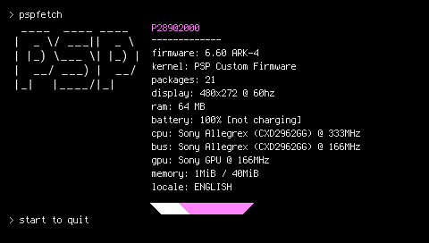
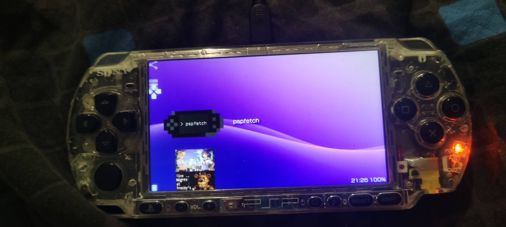

# pspfetch

### [english readme version / английская версия readme](./README.md)

Приложение для PSP, вдохновлённое neofetch.

# Установка

Скопируйте папку приложения в /PSP/GAME/ (папка приложения должна содержать EBOOT.PBP).

# Спасибо:

1. seandear(@antim0118) за помощь с шрифтом, иконкой приложения, фоном, именем в XMB и исправление багов
2. @krazynez за добавление поддержки ARK4, подсчёт пакетов, авто-определение шины/частоты CPU и использование памяти
3. @NobleEpuz за помощь с шрифтом спрайтов

# Особенности:

1. Быстрая смена цвета.
2. Быстрая смена ASCII-арта.
3. Настройка цветных индикаторов.
4. Перезагрузка приложения кнопкой CIRCLE.
5. Включение/выключение USB кнопкой SQUARE.
6. Выход из приложения кнопкой START.
